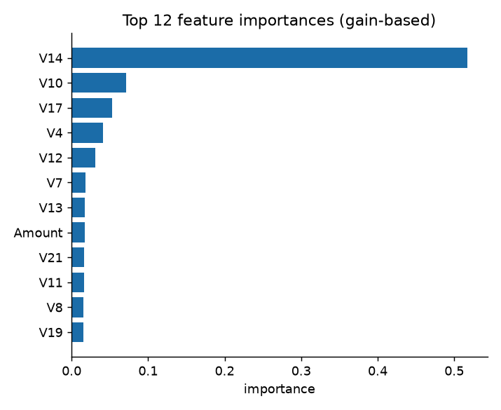
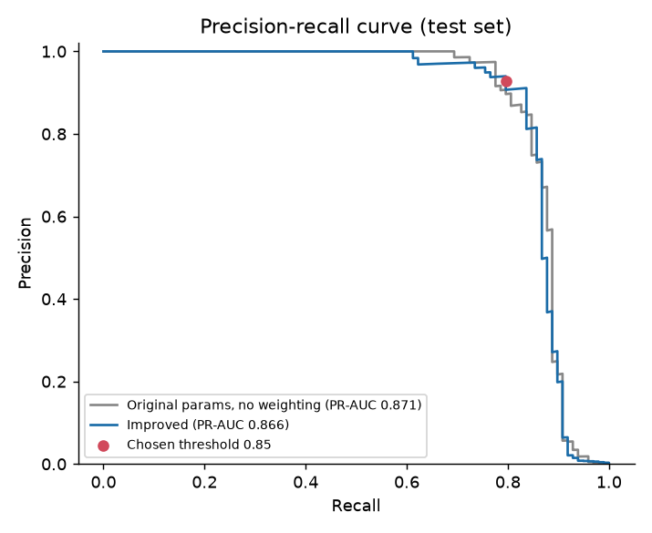
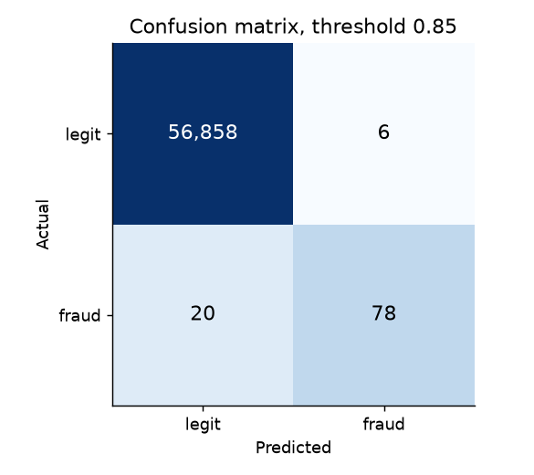
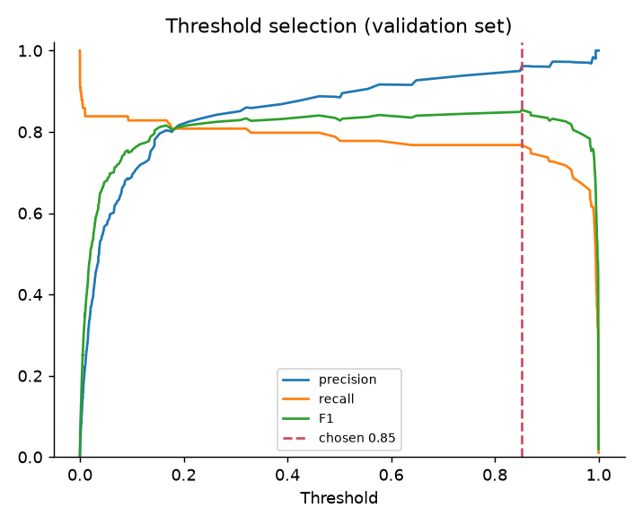
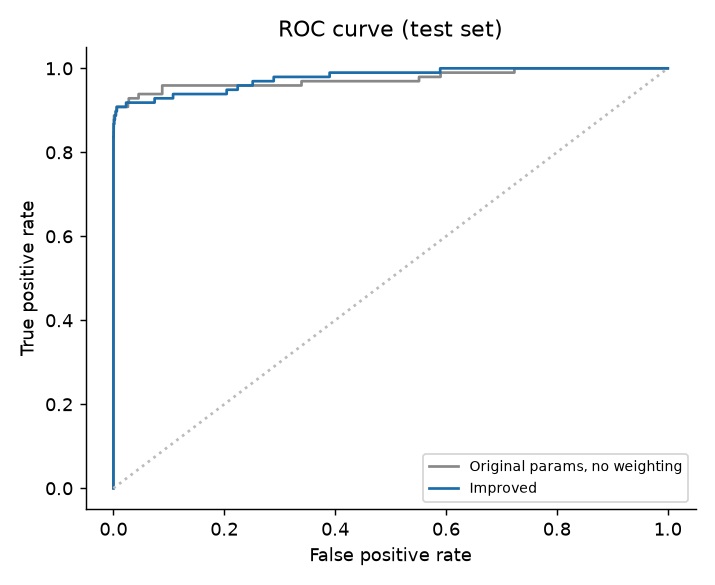
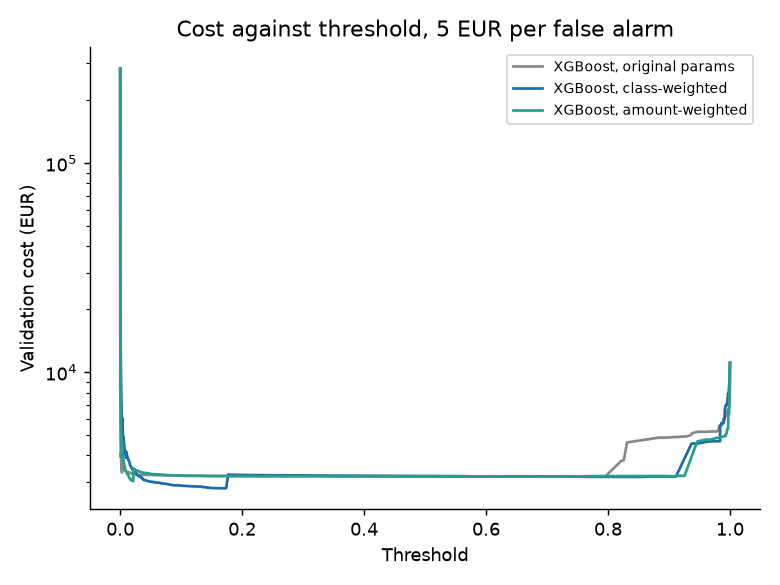
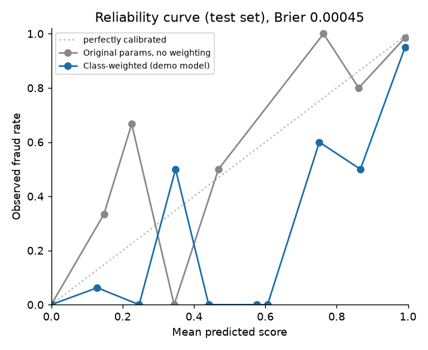

# Credit card fraud detection

[](https://github.com/MohamedHechmiZammel/credit-card-fraud-detection/actions/workflows/ci.yml)

**TL;DR.** Fraud detection on the ULB credit card data (284,807 transactions, 0.17% fraud): a reproduction of a 2024 team project, then a rebuild with a leak-free split, cross-validation, baselines and a cost-based view in EUR. Honest result: XGBoost reaches F1 0.86 +- 0.02 and PR-AUC 0.86 +- 0.03 over 5 folds, and neither class weighting, amount weighting nor a cost-based threshold beats a plain XGBoost by more than that spread.
Demo: coming soon (Hugging Face Space).

Detects fraudulent card transactions with a Decision Tree and XGBoost, and judges them by precision, recall, F1, PR-AUC and money lost instead of accuracy. Originally built as a 5-person team project at ESPRIT (2024); this is my reproducible rebuild.

## What is in the repo

| Path | Content |
|---|---|
| `scripts/download_data.py` | Downloads the dataset, checks its pinned sha256, shape and fraud count |
| `scripts/reproduce.py` | The original 2024 pipeline and both grid searches |
| `scripts/train_improved.py` | Stratified split, baselines, class weighting, validation threshold, calibration |
| `scripts/cross_validate.py` | Stratified 5-fold cross-validation with fixed parameters, writes `reports/cv.json` |
| `scripts/cost_analysis.py` | Cost-based thresholds and amount-weighted training, writes `reports/cost.json` |
| `scripts/make_report.py` | Builds `reports/results.md` from the JSON results |
| `scripts/build_space.py` | Assembles `space/`, a ready-to-upload Hugging Face Space (nothing is uploaded) |
| `src/fraud/` | Data checks, model helpers, threshold logic, cost model, cross-validation, metrics |
| `app/app.py` | Gradio demo using `data/sample.csv` and `models/xgb_fraud.joblib` |
| `tests/` | pytest suite: schema, thresholds, cost arithmetic, smoke tests of the pipelines on synthetic data |
| `reports/` | `results.md`, JSON results, figures |
| `Makefile` | One target per step, with expected runtimes |

## Dataset

ULB / Worldline credit card fraud data: two days of European card transactions from September 2013. Features are `Time`, `Amount` (in EUR), and 28 anonymized PCA components `V1` to `V28`. The target is `Class` (1 = fraud).

`scripts/download_data.py` fetches `creditcard.csv` from the Hugging Face mirror `David-Egea/Creditcard-fraud-detection`, compares its sha256 with a pinned value, and checks 284,807 rows and 492 frauds. The download goes to a temporary file and is moved into place only after the checks pass. Why this mirror: Kaggle needs a login, and OpenML id 1597 (same rows and columns, including `Time`) marks `Time` as its row-id attribute, so loaders such as scikit-learn's `fetch_openml` drop it from the features, and it comes as ARFF or parquet rather than the original CSV. The mirror is the plain CSV, so one hash pins it. The file is about 150 MB and is not committed.

License: the original data is released by the ULB Machine Learning Group under the Database Contents License (DbCL) v1.0. The Hugging Face mirror tags itself MIT, which does not change the original terms. Check the original terms before redistributing the data. Citation: Dal Pozzolo, Caelen, Johnson, Bontempi, "Calibrating Probability with Undersampling for Unbalanced Classification", IEEE SSCI 2015.

## How to run

```bash
python3 -m venv .venv && . .venv/bin/activate
pip install -r requirements-dev.txt        # CPU only; requirements.txt alone is enough to train and run the demo
make data         # about 1 min
make reproduce    # about 33 min: Decision Tree grid (12 min) plus the 54-combination XGBoost grid (21 min)
make improve      # about 1 min, writes model, figures, sample
make cv           # about 1.5 min, writes reports/cv.json
make cost         # about 15 s, writes reports/cost.json
make report       # writes reports/results.md
make test         # a few seconds
make space        # rebuilds space/ from app/ and models/
python app/app.py # demo on http://127.0.0.1:7860
```

`make all` runs every step (about 40 minutes, nearly all of it in `reproduce`). `make improve`, `cv` and `cost` need the XGBoost params saved by `reproduce` and stop with an error if they are missing. The tests and the demo do not need the full dataset. CI runs `ruff check` and `pytest` on Python 3.12 and checks that `python scripts/build_space.py` leaves `space/` unchanged.

## Results

Full tables and notes are in [reports/results.md](reports/results.md). The two sections below use different test sets, so do not compare numbers across them.

### Reproduction against the 2024 deck

Same preprocessing and split as the original: StandardScaler fitted on all rows, `train_test_split(test_size=0.3, random_state=42)`, 5-fold GridSearchCV, same grids. 85,443 test rows, 136 frauds.

| Model | Version | TN | FP | FN | TP | Accuracy |
|---|---|---|---|---|---|---|
| Decision Tree | Original deck | 85290 | 17 | 27 | 109 | 0.99949 |
| Decision Tree | Reproduced, scoring = accuracy | 85290 | 17 | 27 | 109 | 0.99949 |
| Decision Tree | Reproduced, scoring = roc_auc | 85287 | 20 | 30 | 106 | 0.99941 |
| XGBoost | Original deck | not shown | not shown | not shown | not shown | 0.99964 |
| XGBoost | Reproduced, scoring = accuracy | 85300 | 7 | 29 | 107 | 0.99958 |

The notebook text says the grid search used `scoring="roc_auc"`. The deck's Decision Tree numbers only come out with scikit-learn's default scoring, which is accuracy, so the deck was probably made with different code than the notebook shows. Running with roc_auc picks a different tree and gives 20 FP and 30 FN. `scripts/reproduce.py` therefore defaults to `--scoring accuracy`, the same as the commands above, and `--scoring roc_auc` follows the notebook. The XGBoost accuracy is 5 transactions short of the deck (the original XGBoost version and tree method were not recorded).

The reproduction keeps the original's data leakage on purpose: the StandardScaler is fitted on all rows before the split, so test-set statistics reach the training data. It is there only to match the deck. The rebuilt pipeline below has no such step.

### Rebuilt evaluation (stratified split, no leakage)

Stratified 60/20/20 split, 98 frauds in the test set. Thresholds are chosen on the validation split (best F1) and applied once to the test set.

| Model | Threshold | Precision | Recall | F1 | PR-AUC | ROC-AUC | FP | FN |
|---|---|---|---|---|---|---|---|---|
| Always legit (Dummy) | 0.50 | 0.000 | 0.000 | 0.000 | 0.002 | 0.500 | 0 | 98 |
| Logistic regression, scaled, balanced | 0.50 | 0.062 | 0.918 | 0.116 | 0.718 | 0.973 | 1370 | 8 |
| Logistic regression, validation threshold | 1.00 | 0.800 | 0.816 | 0.808 | 0.718 | 0.973 | 20 | 18 |
| XGBoost, original params, no weighting | 0.50 | 0.974 | 0.755 | 0.851 | 0.871 | 0.975 | 2 | 24 |
| XGBoost, original params, validation threshold | 0.39 | 0.950 | 0.776 | 0.854 | 0.871 | 0.975 | 4 | 22 |
| XGBoost, class-weighted | 0.50 | 0.872 | 0.837 | 0.854 | 0.866 | 0.978 | 12 | 16 |
| XGBoost, class-weighted, validation threshold | 0.85 | 0.929 | 0.796 | 0.857 | 0.866 | 0.978 | 6 | 20 |

Two things stand out. Plain XGBoost with its original parameters is already as good as anything I added: with a validation threshold it scores F1 0.854 against 0.857 for the class-weighted model, a difference of one transaction. And logistic regression, the cheap baseline, gets F1 0.81 but a much lower PR-AUC (0.72 against 0.87), so the trees earn their place. With 98 frauds in the test set, one extra missed fraud moves recall by one point. Accuracy is 99.95% for every XGBoost row and 99.83% for the always-legit Dummy, which is why it is not the headline.

### Cross-validation

Stratified 5-fold, fixed parameters, no grid search. In every fold the training part is split again: 80% fits the model and a stratified 20% slice picks the threshold (best F1). The held-out fold is scored once. Mean +- sample standard deviation over the 5 folds:

| Model | Precision | Recall | F1 | PR-AUC | ROC-AUC |
|---|---|---|---|---|---|
| Always legit (Dummy) | 0.000 +- 0.000 | 0.000 +- 0.000 | 0.000 +- 0.000 | 0.002 +- 0.000 | 0.500 +- 0.000 |
| Logistic regression (balanced) | 0.834 +- 0.027 | 0.754 +- 0.033 | 0.792 +- 0.023 | 0.724 +- 0.034 | 0.975 +- 0.009 |
| XGBoost, original params | 0.951 +- 0.023 | 0.789 +- 0.030 | 0.862 +- 0.020 | 0.850 +- 0.025 | 0.979 +- 0.012 |
| XGBoost, class-weighted | 0.906 +- 0.023 | 0.815 +- 0.045 | 0.857 +- 0.024 | 0.857 +- 0.026 | 0.981 +- 0.009 |
| XGBoost, amount-weighted | 0.912 +- 0.031 | 0.797 +- 0.025 | 0.850 +- 0.022 | 0.843 +- 0.038 | 0.982 +- 0.009 |

This replaces the single test split as the source for how much a result can move. Recall of the class-weighted model has a standard deviation of 4.5 points across folds and F1 of 2.4 points, so any gap of one or two points between the XGBoost variants is noise. The amount-weighted and class-weighted models are not distinguishable from the unweighted one on any metric.

### Cost-sensitive view

A missed fraud costs its full Amount. A false alarm costs a flat amount, set to 5 EUR here. That number is my assumption, not data: it stands for analyst time and customer friction, and the table below shows 1 and 20 EUR as well. Chargeback fees and churn are ignored, and caught frauds cost nothing (`--review-caught-fraud` charges them one false-alarm cost too). Amounts are in EUR, as in the dataset.

Amount-weighted training gives each fraud row the weight `min(1 + Amount / median fraud Amount, 20)` and each legitimate row 1, with no `scale_pos_weight`. The "min cost" threshold minimizes cost on the validation split. The test set holds 98 frauds worth 10,645 EUR in total (median 10.34 EUR), so approving everything costs 10,645 EUR.

| Model | Threshold rule | Threshold | Test cost (EUR) | Saved (EUR) | False alarms | Missed frauds |
|---|---|---|---|---|---|---|
| No model (approve everything) | n/a | n/a | 10,645 | 0 | 0 | 98 |
| XGBoost, original params | 0.5 | 0.500 | 3,004 | 7,641 | 2 | 24 |
| XGBoost, original params | best F1 on validation | 0.394 | 2,807 | 7,838 | 4 | 22 |
| XGBoost, original params | min cost on validation | 0.781 | 3,005 | 7,640 | 2 | 25 |
| XGBoost, class-weighted | 0.5 | 0.500 | 1,993 | 8,652 | 12 | 16 |
| XGBoost, class-weighted | best F1 on validation | 0.852 | 2,423 | 8,222 | 6 | 20 |
| XGBoost, class-weighted | min cost on validation | 0.167 | 1,957 | 8,688 | 25 | 14 |
| XGBoost, amount-weighted | 0.5 | 0.500 | 1,975 | 8,670 | 8 | 18 |
| XGBoost, amount-weighted | best F1 on validation | 0.231 | 1,908 | 8,737 | 15 | 15 |
| XGBoost, amount-weighted | min cost on validation | 0.021 | 2,186 | 8,459 | 71 | 13 |

Sensitivity of the test cost (EUR) to the false-alarm cost, with false alarms (FA) and missed frauds for each choice:

| False-alarm cost (EUR) | Class-weighted, F1 threshold | Class-weighted, min-cost threshold | Amount-weighted, F1 threshold | Amount-weighted, min-cost threshold |
|---|---|---|---|---|
| 1 | 2,399 (6 FA, 20 missed) | 2,097 (803 FA, 9 missed) | 1,848 (15 FA, 15 missed) | 2,466 (643 FA, 10 missed) |
| 5 | 2,423 (6 FA, 20 missed) | 1,957 (25 FA, 14 missed) | 1,908 (15 FA, 15 missed) | 2,186 (71 FA, 13 missed) |
| 20 | 2,513 (6 FA, 20 missed) | 2,332 (25 FA, 14 missed) | 2,133 (15 FA, 15 missed) | 2,332 (3 FA, 24 missed) |

Cross-validated, per held-out fold. Approving everything costs 12,026 EUR on average:

| Model | Threshold rule | Cost per fold (EUR) | Saved vs no model (EUR) |
|---|---|---|---|
| XGBoost, original params | f1 | 3,664 +- 1,227 | 8,362 +- 2,885 |
| XGBoost, original params | cost | 3,417 +- 1,773 | 8,609 +- 2,766 |
| XGBoost, class-weighted | f1 | 3,095 +- 1,489 | 8,930 +- 2,834 |
| XGBoost, class-weighted | cost | 3,319 +- 1,608 | 8,707 +- 2,815 |
| XGBoost, amount-weighted | f1 | 3,042 +- 1,420 | 8,984 +- 2,968 |
| XGBoost, amount-weighted | cost | 3,174 +- 2,134 | 8,851 +- 3,062 |

What this shows. Every XGBoost variant saves between about 70% and 82% of the fraud amount compared with approving everything. On the single test split the min-cost threshold looks best for the class-weighted model (1,957 EUR against 2,423 EUR for the F1 threshold, saving 8,688 EUR), but it is worse for the amount-weighted model, and in cross-validation the cost rule is not better than the F1 rule (3,319 against 3,095 EUR for the class-weighted model). The fold-to-fold standard deviation is about 1,500 EUR because a few large frauds decide each fold, so cost differences of a few hundred EUR are not evidence. The cost curve varies little between thresholds 0.05 and 0.9 ([figure](reports/figures/cost_curve.png)), which is why the minimum moves around. At 1 EUR per false alarm the class-weighted minimum lands at a threshold of 0.003 and flags 803 legitimate transactions to catch 11 more frauds than the F1 threshold does.

### Calibration

Brier score on the test set, lower is better:

| Model | Brier score (test) |
|---|---|
| Constant (training fraud rate) | 0.00172 |
| XGBoost, original params, no weighting | 0.00041 |
| XGBoost, class-weighted | 0.00045 |
| Logistic regression, balanced | 0.02205 |

The class-weighted model is slightly worse than the unweighted one (0.00045 against 0.00041): `scale_pos_weight` pushes scores up, and its reliability curve sits below the diagonal ([figure](reports/figures/calibration.png), noisy because few frauds fall in each bin). I did not calibrate it. The demo labels its output "fraud score (not a calibrated probability)", because it only needs a ranking and a threshold.

### Feature importance



Gain-based importance of the class-weighted model. `V1` to `V28` are anonymized PCA components, so a high bar says which component the trees split on, not what a human analyst should look at. It is not an explanation of fraud.

### Figures

| | |
|---|---|
|  |  |
|  |  |
|  |  |

## Demo

`python app/app.py` opens a Gradio app. Pick one of 200 held-out transactions (40 frauds, 160 legitimate, from the test split), move the threshold slider, and read the fraud score, the decision and the precision-recall curve. The sample has 20% frauds against 0.17% in reality, so its curve is illustrative only.

## Limitations

- About 100 frauds in the test set make every fraud metric noisy. Across the 5 cross-validation folds, recall of the class-weighted model varies with a standard deviation of 4.5 points.
- The reproduction section keeps the original scaler leakage (fitted on all rows before the split) so it can match the deck. Its numbers and the rebuilt tables come from different test sets and must not be compared directly.
- The data is from two days in 2013, and 28 features are anonymized PCA outputs. There is no way to check what the model relies on, and no guarantee it transfers to current card traffic.
- `Time` is seconds since the first transaction. A random split mixes past and future, which is optimistic. A time-based split would be stricter, and I did not run one.
- The original XGBoost grid includes `booster="dart"`. XGBoost 3.x marks it as deprecated. It never won the grid search here.
- The XGBoost reproduction is not exact (5 transactions on accuracy).
- The cost numbers rest on an assumed false-alarm cost and on Amount being the whole loss. Real costs include fees, investigation time and lost customers. The model scores are not calibrated probabilities.
- The cross-validation reuses the number of trees and the weighting chosen on the single validation split, so it measures variance, not an unbiased estimate of tuned performance.

## License

MIT for the code, see [LICENSE](LICENSE). The dataset keeps its own license, see above.
