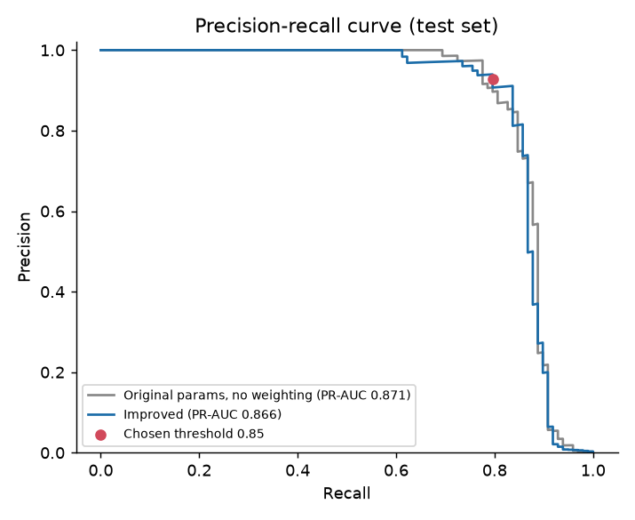
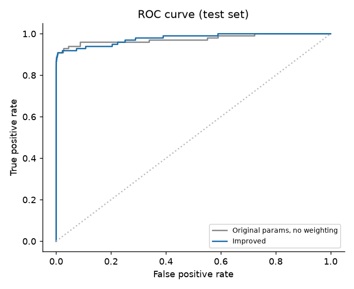
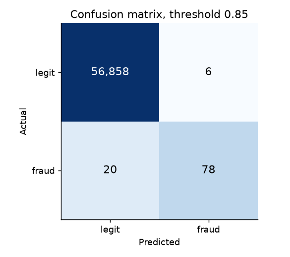
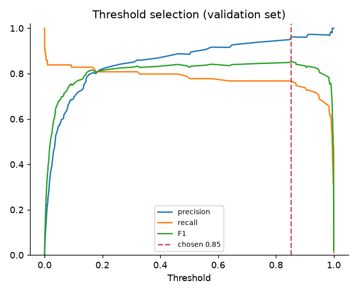
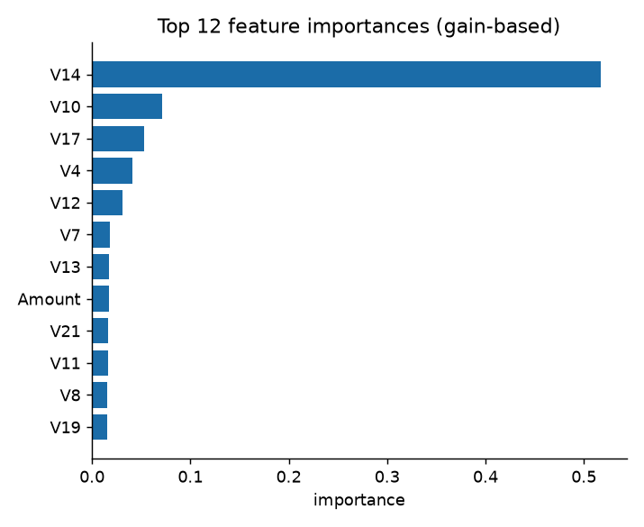

# Results

All numbers are produced by the scripts in `scripts/`. Test sets differ between the two sections, see notes.

## 1. Reproduction of the original 2024 pipeline

Original recipe: StandardScaler on the whole dataset, `train_test_split(test_size=0.3, random_state=42)`, GridSearchCV with 5-fold CV (scoring noted per row). 85,443 test rows with 136 frauds (same as the deck).

| Model | Source | TN | FP | FN | TP | Accuracy | Precision | Recall | F1 |
|---|---|---|---|---|---|---|---|---|---|
| Decision Tree | Original deck | 85290 | 17 | 27 | 109 | 0.99949 | 0.8651 | 0.8015 | 0.8321 |
| Decision Tree | Reproduced (CV scoring = accuracy) | 85290 | 17 | 27 | 109 | 0.99949 | 0.8651 | 0.8015 | 0.8321 |
| Decision Tree | Reproduced (CV scoring = roc_auc, as in the notebook) | 85287 | 20 | 30 | 106 | 0.99941 | 0.8413 | 0.7794 | 0.8092 |
| XGBoost | Original deck | not shown | not shown | not shown | not shown | 0.99964 | n/a | n/a | n/a |
| XGBoost | Reproduced (CV scoring = accuracy) | 85300 | 7 | 29 | 107 | 0.99958 | 0.9386 | 0.7868 | 0.8560 |

Decision Tree best params (accuracy scoring): `{'criterion': 'gini', 'max_depth': 10, 'min_samples_split': 10}`, full 18-combination grid. With roc_auc scoring the search picks `{'criterion': 'entropy', 'max_depth': 10, 'min_samples_split': 10}` instead.
XGBoost best params (accuracy scoring): `{'booster': 'gbtree', 'learning_rate': 0.1, 'max_depth': 5, 'n_estimators': 200}`, full 54-combination grid with 5-fold CV (run on CPU in about 21 minutes, so no shortcut was needed).

The Decision Tree row matches the deck exactly when the grid search uses scikit-learn's default scoring (accuracy). The notebook text says `scoring='roc_auc'`, but the deck's numbers only come out with the default, so the deck was probably produced by an earlier version of the code. The XGBoost accuracy does not match exactly (deck 0.99964, reproduced 0.99958, a difference of about 5 transactions out of 85,443). A likely cause is a different XGBoost version or tree method (the original run is not recorded). The deck shows the XGBoost confusion matrix only as an image, so only its accuracy is a hard reference.

## 2. Improved pipeline

Stratified 60/20/20 split (train 170,883 / validation 56,962 / test 56,962, 98 frauds in test). Class weighting through `scale_pos_weight`, early stopping on validation PR-AUC, no scaler (trees do not need one). The threshold is the best-F1 point on the validation split. Accuracy is shown last on purpose: predicting "legit" for everything already scores 99.83%.

| Model | Threshold | Precision | Recall | F1 | PR-AUC | ROC-AUC | TN | FP | FN | TP | Accuracy |
|---|---|---|---|---|---|---|---|---|---|---|---|
| XGBoost, original params, no weighting | 0.500 | 0.9737 | 0.7551 | 0.8506 | 0.8712 | 0.9745 | 56862 | 2 | 24 | 74 | 0.99954 |
| XGBoost, original params, threshold from validation | 0.394 | 0.9500 | 0.7755 | 0.8539 | 0.8712 | 0.9745 | 56860 | 4 | 22 | 76 | 0.99954 |
| Improved, threshold 0.5 | 0.500 | 0.8723 | 0.8367 | 0.8542 | 0.8657 | 0.9779 | 56852 | 12 | 16 | 82 | 0.99951 |
| **Improved, validation-chosen threshold (best F1)** | 0.852 | 0.9286 | 0.7959 | 0.8571 | 0.8657 | 0.9779 | 56858 | 6 | 20 | 78 | 0.99954 |
| Improved, high-recall mode (threshold for recall >= 0.85 on validation) | 0.010 | 0.2268 | 0.8980 | 0.3621 | 0.8657 | 0.9779 | 56564 | 300 | 10 | 88 | 0.99456 |

Improved model: `scale_pos_weight=24.0`, `max_depth=3`, `learning_rate=0.1`, 317 trees (early stopping). Validation PR-AUC 0.8301.

## Notes

- Sections 1 and 2 use different test sets (random 30% versus stratified 20%), so compare rows within a section, not across.
- The original scaler was fitted on all rows before splitting. That leaks test statistics. It is kept in section 1 only to match the deck.
- With only ~100 frauds in the test set, one extra miss moves recall by about one point. Treat differences of a few points as noise.
- Weighting did not raise PR-AUC here (0.866 versus 0.871 for the unweighted baseline), and that gap is inside the noise. What the rebuild adds is a leak-free split, honest metrics and a threshold that was picked without looking at the test set.
- The high-recall row shows the cost of chasing recall: about 300 extra false alarms for 10 more frauds caught.
- ROC-AUC looks excellent for almost any model on this data. PR-AUC and recall at a given precision are the more honest numbers.

## Figures

